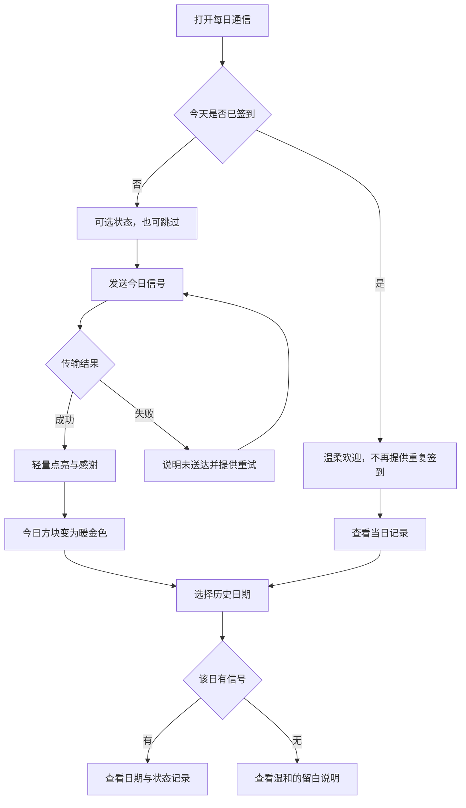
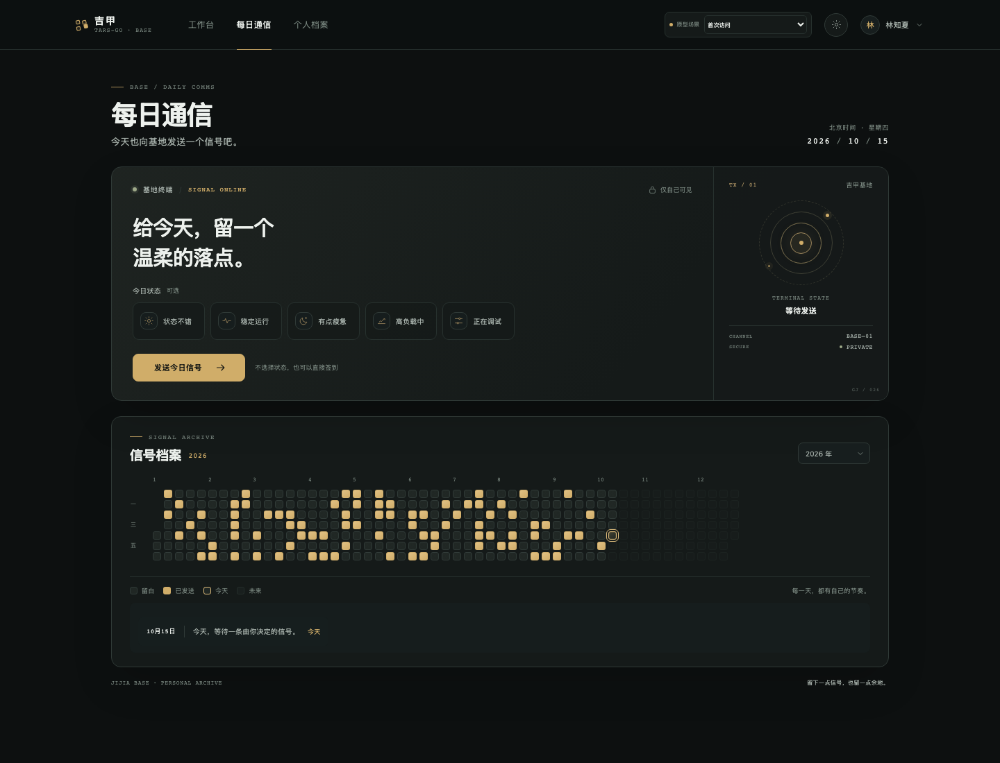
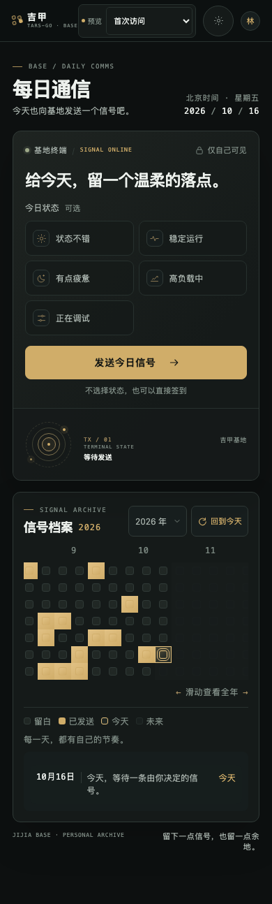

# 吉甲基地 · 每日通信：P0 原型与设计说明

关联 [总规划 #66](https://github.com/Tyr1onX/tarsgo-website/issues/66) 与 [设计 Issue #67](https://github.com/Tyr1onX/tarsgo-website/issues/67)。本页记录 P0 静态原型与设计依据；正式页面、接口及数据边界见 [P1 实施说明](./p1-implementation.md)。静态原型仍不调用接口或写入数据。

官网三个空间及基地入口的当前信息架构见[吉甲基地说明](../gijia-base/README.md)。

## 原型入口

在仓库根目录启动任意静态文件服务器，打开 `docs/prototypes/daily-signal/index.html`。页面右下角「原型场景」可切换首次访问、重复访问、高负载已签到、发送失败和空白档案；演示状态只存在于当前页面内存，刷新即重置。顶部主题按钮可切换夜间黑金与日间白金。

原型代码：[index.html](../../prototypes/daily-signal/index.html)、[prototype.css](../../prototypes/daily-signal/prototype.css)、[prototype.js](../../prototypes/daily-signal/prototype.js)。所有演示用户、日期与签到日均为虚构数据，原型没有持久化行为。

## 设计说明

### 基地每日通信终端

- 延续现有工作台的深墨色、细边框、低饱和金色和留白；浅色主题采用陶瓷白、石墨字色与香槟金。
- 左侧是操作区域，右侧是小型通信舱。刻度、同心环、细网格线表达设备感；把金色点分散在规整框架内，体现「错位的秩序」，日期网格本身保持准确、整齐。
- `SIGNAL ONLINE`、`TX / 01`、`SIGNAL RECEIVED` 只在对应状态出现，不以大面积霓虹、粒子或声音制造仪式感。
- 「仅自己可见」提醒只放在通信终端附近，与情绪隐私原则对应；不展示基地参与人数、队组比较或个人总榜。

### 状态选择与发送反馈

「今日状态 · 可选」的五项样例是「状态不错、稳定运行、有点疲惫、高负载中、正在调试」。点击已选项可以取消；不选择也能直接点「发送今日信号」。疲惫状态收到中性感谢，不被改写成积极状态或诊断。

发送后，按钮短暂显示「正在发送…」，终端指示环柔和点亮，随后显示收到回执和感谢文案、点亮今天的方块。重复访问时不出现再次签到按钮，显示「今天已经见过你啦」。模拟失败场景展示可重试反馈；恢复后仍只点亮当天一个方块。

当天已经签到时，原型把已选状态显示为只读；没有选择状态时显示「今天没有选择状态」，不再保留可点击的情绪选项。这是等待 #67 决策前的临时交互约定，不代表产品已决定不支持修改。

动画不播放声音。`prefers-reduced-motion: reduce` 会收短页面过渡与传输动画；原型也支持在 URL 后加 `?motion=reduce` 预览该状态。

### 年度信号档案

- 每列一周、每行一周中的一天，按日期排列；整年展示，允许切换 2024、2025、2026 年。
- 已发送日使用同一层级的暖金色，不暗示活跃等级；留白日使用带细边的石墨 / 陶瓷方块；今天使用细金色轮廓；未来日期降低对比并禁用选择。
- 移动端首次打开默认定位到今天所在周；签到成功后回到今天并点亮当天方块。查看历史时滚动位置不会被自动抢回；点击「回到今天」可主动返回。
- 移动端每个方块保留原有约 12px 的材质视觉，触控目标扩大到 24px；年份、日期、状态、图例与说明文字调大，关键按钮至少 44px 高。
- 桌面用鼠标悬停或键盘聚焦、移动端点击日期，查看当日回执或温和留白文案。空白日说明「这一天没有留下基地信号，但生活仍在继续」。
- 窄屏把年度图限制在档案卡片内部横向滚动，不让页面整体横向溢出；键盘可用方向键移动日期，焦点和读屏名称包含日期及状态。

## 交互流程

## 状态覆盖

| 状态 | 原型场景 | 终端与档案反馈 |
| --- | --- | --- |
| 首次访问 / 尚未发送 | 首次访问 | 无状态选择；今天描边但不点亮；按钮可直接发送 |
| 可选状态后发送 | 首次访问，选一项状态 | 发送中短反馈，成功后只点亮当天一个格子并显示感谢 |
| 跳过状态后发送 | 首次访问，不选状态 | 成功文案不要求补填状态 |
| 当天重复访问 | 今天已签到 · 重复访问 | 显示「今天已经见过你啦」，不提供重复发送入口 |
| 已签到并记录状态 | 今天已签到 · 高负载 | 显示状态回执和不施压的感谢 |
| 网络 / 发送失败 | 发送失败 · 可重试 | 保持未签到状态，提示可重试；重新发送后完成模拟 |
| 空白档案 | 空白档案 | 过去格子全部留白但有细腻材质；未来和今天仍按真实时间状态展示 |
| 历史日期 | 点选热力图日期 | 已签到日和留白日都能阅读，不出现缺勤、漏签或失败文案 |
| reduced motion | 系统减少动态，或 `?motion=reduce` | 不播放扩散动画；签到结果与状态信息照常可读 |

## 本轮评审反馈调整

- 首次载入和签到成功后将今日所在周放入移动端可视区；自由查看历史日期时不自动改动滚动位置；年份切换后可使用「回到今天」切回 2026 年。
- 增大移动端必须理解的状态、隐私、日期、图例、结果文字与主要触控控件；方块外观、圆角、配色和层级保留，扩大的是方块触控框。
- 已签到后只显示已保存的情绪只读项；无情绪签到时明确显示未选择，不允许再次点选造成已保存的错觉。

## 产品决策与仍待确认事项

结合 #66～#68 的后续确认，静态原型中的以下问题已经不再是未决项：

1. **使用范围**：任何访客都能打开页面浏览档案界面；只有登录用户能发送信号。访客接口只返回空白个人档案，不展示其他人的日期或情绪。当前主导航入口为「吉甲基地」，每日通信是基地内已开放的首个功能。
2. **日期口径**：由服务端统一使用 `Asia/Shanghai`，北京时间零点换日；不采信客户端传入日期。页面跨过零点后刷新当天状态。
3. **状态修改与删除**：当天可修改或清空自己的状态，不新建签到行；本人可以删除历史情绪，但签到日期保留。历史状态不提供修改，不能撤销整日签到。
4. **隐私边界**：真实日期与情绪仅由当前账号读取；普通用户、管理员和超级管理员都没有查看他人情绪的业务接口；本期不做公共汇总。
5. **重试与重复**：同一账号同一天重复或并发发送返回现有记录，不覆盖已保存情绪；网络失败可用原请求重试。

仍待确认：数据保留期限、是否提供整日签到撤回、历史情绪修改政策是否以后调整、是否有必要公开不含个人情绪的基地汇总数据。它们均不在 P1 实现范围。原型中的 `2026-10-16` 和热力图参与日均为虚构数据。

## 后续开发建议

1. P1 实施说明已将身份、隐私、北京时间和状态变更规则落入接口与数据库约束，并在隔离账号中验收；具体证据见 [P1 实施说明](./p1-implementation.md)。
2. 后续只在评审实际体验后修订当前范围；感谢文案扩充和随机内容仍可单独评估 #69，签到接口与唯一性不依赖这些内容。
3. 集体热力图、年度回顾、五组视觉、虚拟共建继续留在 #70 探索；没有读取个人状态的汇总实现。

## 浏览器验证记录

使用真实 Chromium 153.0.8010.12 检查了 1440、1024、768、390、320 像素视口。页面整体没有横向溢出；移动端热力图默认显示十月的今天所在周，年度图在档案卡片内部横向滚动。

- 已实际操作：可选状态与无状态直签到成功、签到后情绪只读、短暂发送中状态、当天重复访问、失败后重试、空白档案、历史留白/已发送日期查看、年份切换、回到今天、键盘方向键、鼠标悬停与触屏点选。
- 已检查：黑金 / 白金、系统 reduced-motion 下动画缩短、320 / 390 / 768 / 1024 / 1440 像素页面宽度、按钮触控尺寸、浏览器运行期错误。运行期错误为 0。
- 此验证只覆盖静态交互原型，不代表正式接口、认证、时区边界或持久化能力已经实现。

截图均由本原型在 Chromium 中实际渲染，文件可直接在仓库中查看：

| 场景 | 截图 |
| --- | --- |
| 桌面黑金 · 首次访问 | [desktop-dark-first-visit.png](screenshots/desktop-dark-first-visit.png) |
| 桌面白金 · 首次访问 | [desktop-light-first-visit.png](screenshots/desktop-light-first-visit.png) |
| 桌面黑金 · 发送中（已选疲惫状态） | [desktop-dark-sending.png](screenshots/desktop-dark-sending.png) |
| 桌面黑金 · 重复访问 | [desktop-dark-repeat-visit.png](screenshots/desktop-dark-repeat-visit.png) |
| 桌面黑金 · 发送失败 | [desktop-dark-network-failure.png](screenshots/desktop-dark-network-failure.png) |
| 桌面黑金 · 空白档案 | [desktop-dark-empty-archive.png](screenshots/desktop-dark-empty-archive.png) |
| 768 像素 · 平板布局 | [tablet-768-dark.png](screenshots/tablet-768-dark.png) |
| 390 像素 · 移动黑金 | [mobile-390-dark.png](screenshots/mobile-390-dark.png) |
| 390 像素 · 移动白金 | [mobile-390-light.png](screenshots/mobile-390-light.png) |
| 390 像素 · 无情绪签到后今日点亮 | [mobile-390-dark-today-no-mood-signed.png](screenshots/mobile-390-dark-today-no-mood-signed.png) |
| 390 像素 · 今日已签到，只读情绪 | [mobile-390-dark-today-signed.png](screenshots/mobile-390-dark-today-signed.png) |

### 桌面与移动预览

